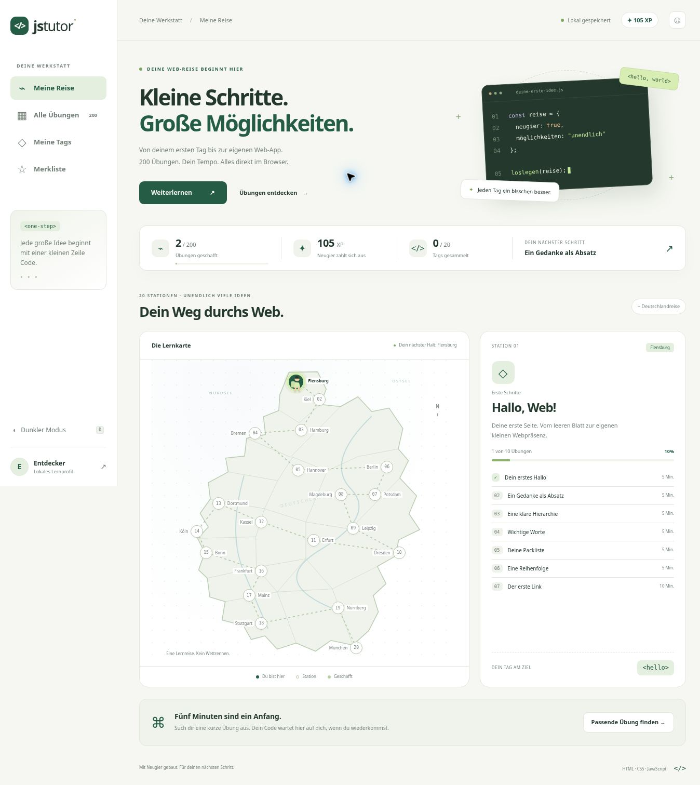
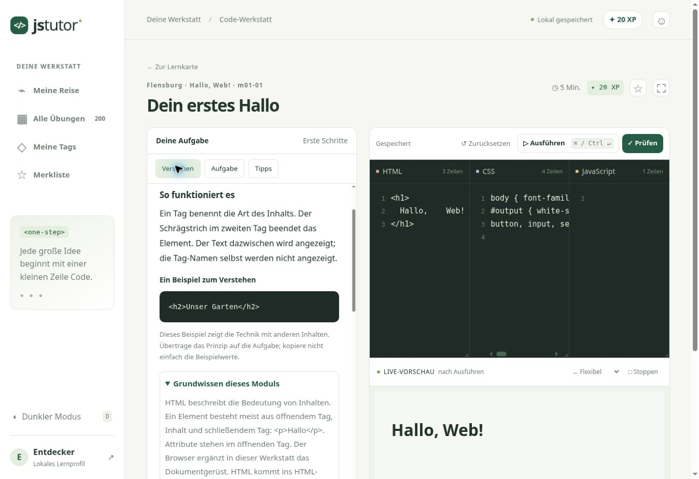
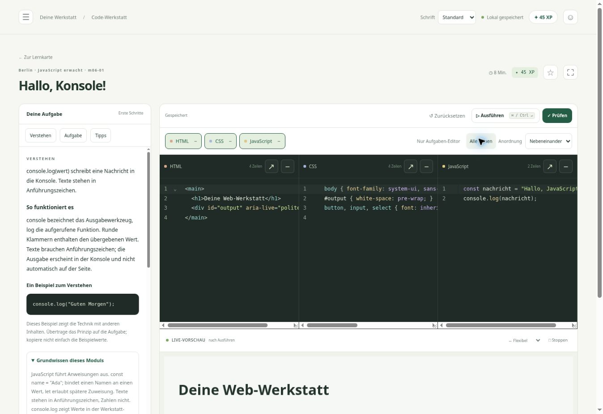

# jstutor — Deine Web-Reise

Eine eigenständige, deutschsprachige Browser-Werkstatt mit **200 Übungen in 20 Modulen**: vom ersten HTML-Tag über modernes CSS und JavaScript bis zu Zustandsverwaltung, asynchronen Daten, Komponenten, Canvas und Architekturbausteinen.

## Benutzen

- Drei getrennte Editoren, Vorschau, Konsole und automatische Lernprüfungen.
- **⌘/Strg + Enter:** ausführen. **⌘/Strg + Shift + Enter:** prüfen. **D:** Hell-/Dunkelmodus außerhalb von Eingabefeldern. Tab fügt im Editor zwei Leerzeichen ein.
- Geführte Deutschlandreise mit Spielfigur, freie Übungssuche, Zeit-/Niveaufilter, Merkliste, XP und 20 sammelbare Tags.
- Erklärungen, Modulgrundwissen, drei Tipps und kommentierte Musterlösungen. Aufgedeckte Lösungen werden als unterstützt bearbeitet gekennzeichnet. Punkte werden pro Übung nur einmal vergeben.
- Lokale Profile, gespeicherte Entwürfe und versionierter Export/Import für Gerätewechsel. Noch keine Anmeldung oder Synchronisierung.
- Ohne CDN, externe Fonts, Framework oder Laufzeitabhängigkeiten. Lokale Lern-API und flüchtiger Übungsspeicher in der isolierten Vorschau. Nach dem ersten erfolgreichen Cache-Aufbau ist die Anwendung offline nutzbar. Die erste Seite muss einmal erreichbar sein; Netzsperren der eigentlichen Domain kann eine Web-App nicht umgehen.

## Start und GitHub Pages

`index.html` kann ohne Build über einen beliebigen statischen HTTP-Server ausgeliefert werden. `npm run build` kopiert die Anwendung nach `dist/`; `npm test` prüft Inhaltsschema, Syntax und Speicherlogik. Keine npm-Pakete müssen installiert werden.

Der Workflow `.github/workflows/pages.yml` prüft und veröffentlicht bei Push auf `main`. Repository Settings → Pages → Source: **GitHub Actions**. Das private Repository benötigt einen GitHub-Tarif, der Pages für private Repositories unterstützt. Falls das automatische Aktivieren mit `Resource not accessible by integration` scheitert, muss der Repository-Inhaber Pages einmal in den Einstellungen aktivieren und den Workflow erneut starten. Die Sichtbarkeit des Repositorys wird durch dieses Projekt nicht geändert.

## Autoren und Erweiterungen

- [Prompt für neue Übungen](docs/NEUE_UEBUNGEN_PROMPT.md)
- [Vorbereitung für Server, Datenbank und Anmeldung](docs/SERVER_UMZUG.md)
- [SQL-Entwurf](docs/schema.sql)
- `scripts/build_curriculum.py`: reproduzierbare Autorenquelle der ersten 200 Aufgaben.
- `data/m01.js` bis `m20.js`: eigenständige Module ohne Netzabfragen.
- `tests/browser.html`: Browserlauf für alle Musterlösungen. Zum lokalen Testen als `qa.html` in denselben Auslieferungsordner wie `runner.js` kopieren; nicht Teil des Produktionsbuilds.

## Technische Grenzen

Lernprüfungen sind transparent und clientseitig, keine manipulationssicheren Prüfungen. Die lokale Speicherung ist browsergebunden; privater Modus, Speicherlimits und Löschen von Websitedaten können sie entfernen. Export sichert den Stand. API-Aufgaben nutzen deterministische lokale Daten, keine aktuellen Live-Daten. Echte Nutzeranmeldung ist vorbereitet, aber absichtlich nicht aktiviert.

## Validierung

Die Schema-/Syntax-/Speichertests laufen im Pages-Workflow. Musterlösungen werden zusätzlich im echten Browser mit den Prüfungen der Lernumgebung ausgeführt; das Ergebnis des Erstlaufs wird in `docs/VALIDIERUNG.md` festgehalten. Die Gestaltung wurde als eigenständige Werkstatt entwickelt; fsbwit.com diente als Referenz für klare fachliche Kapitelstruktur, Inhalte wurden nicht übernommen.

## Vorschau

## Version 1.1

Ausführlichere Erklärungen und parallele Beispiele für alle 200 Übungen, sichtbare Eingabe-/Ausgabeverträge, Tipps ohne Lösungsblöcke, tolerante DOM-Textprüfung und größere, mit dem Bildschirm skalierende Schrift.

Für den manuellen Webspace-Upload ersetzen: `app.js`, `runner.js`, `styles.css`, `sw.js` und den vollständigen Ordner `data/`. Alternativ den kompletten Inhalt eines frischen `dist/`-Builds hochladen. Die bisherigen Lernstände bleiben im Browser erhalten. Beim ersten Versionswechsel alte Website-Tabs schließen und neu öffnen; nicht die Websitedaten löschen.

## Version 1.1.1 – Schrift selbst wählen

Die ursprüngliche kompakte Schrift ist wieder Standard. Oben in der Kopfzeile kann jeder Nutzer **Standard**, **Groß (+20 %)** oder **Sehr groß (+40 %)** auswählen. Die Einstellung gehört zum lokalen Profil, bleibt nach Neuladen erhalten und wird mit exportiert/importiert. Alte Profile beginnen mit Standard. Die Schrift der eigenen Vorschau wird durch diese UI-Einstellung nicht verändert.

Für dieses Update auf dem Webspace ersetzen: `index.html`, `styles.css`, `app.js`, `storage.js` und `sw.js`. Die Übungsdateien sind unverändert.

## Version 1.2 – Flexible Code-Werkstatt

Die Navigation lässt sich über ☰ ausblenden und wieder einblenden. HTML, CSS und JavaScript sind einzeln minimierbar; die Schaltflächen über den Editoren stellen sie wieder her. ↗ zeigt nur den gewählten Editor, „Nur Aufgaben-Editor“ konzentriert auf die aktuelle Aufgabe. Minimieren entfernt keinen Code; ausgeblendeter Code wird weiterhin in der Vorschau ausgeführt. Neue Übungen öffnen zunächst nur den Aufgaben-Editor. Über „Anordnung“ lassen sich mehrere Editoren nebeneinander oder untereinander anzeigen; schmale Bildschirme brechen Spalten automatisch um. Editorhöhen sind am unteren Rand veränderbar.

CodeMirror 6 liefert Syntax-Highlighting, Zeilennummern, Einrückung, Undo/Redo und Suche. **⌘/Ctrl+Enter** führt aus, **⌘/Ctrl+Shift+Enter** prüft. Navigationszustand und Anordnung gehören zum lokalen Profil; minimierte Editoren werden pro Übungsentwurf gespeichert und mit exportiert. Die Schriftgrößenauswahl bleibt erhalten.

Alle Editor-Dateien liegen lokal in `vendor/`; es gibt keine CDN-Abhängigkeit. `src/editor.js` ist der bearbeitbare Quellcode. Nach Änderungen daran: `npm ci` und `npm run build:editor`. Der fertige Bundle und seine MIT-Lizenztexte werden eingecheckt; der normale statische Build kopiert diese ohne Installation.

**Manueller Webspace-Upload:** `index.html`, `app.js`, `storage.js`, `styles.css`, `sw.js` ersetzen und den vollständigen neuen Ordner **`vendor/`** hochladen. Alternativ den gesamten Inhalt von `dist/` nach `npm run build` übertragen. Bestehende Lernstände bleiben erhalten.

